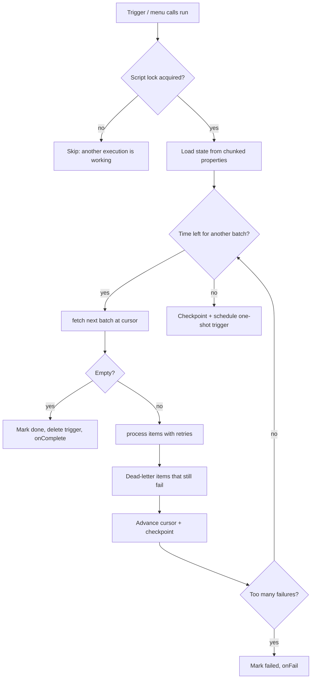

# gas-resumable

**Run Google Apps Script jobs of any size.** Process 50,000 sheet rows, page through a slow API or migrate a whole Drive folder without ever seeing `Exceeded maximum execution time` again.

Apps Script kills every execution after 6 minutes (30 on some Workspace plans). The usual fixes are ad-hoc: a row counter in a cell, a trigger someone forgets to delete, a job that silently restarts from zero. `gas-resumable` turns that into a small, tested engine:

- **Checkpointed batches.** Progress is saved after every batch, so a crash or timeout never loses more than one batch of work.
- **Automatic continuation.** Before the time limit, the job saves its cursor and schedules a one-shot trigger to pick up exactly where it stopped. When it finishes, the trigger is removed.
- **Adaptive time budget.** It measures how long batches take and won't start one it can't finish in time.
- **Retries with exponential backoff + jitter** for transient errors (`Service invoked too many times`, `Timeout`, HTTP 5xx). Mark bad data with `Resumable.permanent()` to skip retries.
- **Dead letters.** Items that keep failing are recorded with their position and error, and the job keeps going. Too many failures and it stops instead of burning quota.
- **No double processing.** A script lock prevents two overlapping executions from handling the same batch.
- **State bigger than 9 KB.** `PropertiesService` caps each value at ~9 KB; job state is transparently split across chunks.
- **Pause, resume, reset, progress**, ready to wire to a custom menu or a status cell.

Zero dependencies. Plain V8 Apps Script.

## Quick start

1. Copy `src/Core.js` and `src/Adapters.js` into your Apps Script project (or `clasp push` this repo and add it as a library).
2. Describe how to **fetch** a batch and how to **process** an item:

```js
function syncInvoices() {
  var sheet = SpreadsheetApp.getActive().getSheetByName('Invoices');

  Resumable.job('syncInvoices', {
    fetch: Resumable.sheetRows(sheet),          // reads only one batch at a time
    process: function (row) {
      // row = { row: 42, values: [...] }
      postToErp(row.values);                     // your slow work here
    },
    continueWith: 'syncInvoices',               // function the trigger will call
    options: { batchSize: 200 }
  }).run();
}
```

3. Run `syncInvoices` once. If the sheet is huge, the job checkpoints at ~4.5 minutes, schedules itself, and continues on its own until done.

### Custom pagination (APIs, Drive, Gmail)

Return `{ items, nextCursor }` and the cursor can be anything JSON-serializable: page tokens, dates, IDs.

```js
fetch: function (cursor, size) {
  var page = Drive.Files.list({ pageSize: size, pageToken: cursor || undefined, q: "'FOLDER_ID' in parents" });
  return { items: page.files || [], nextCursor: page.nextPageToken || null };
}
```

### Bulk writes

Use `processBatch` instead of `process` to write a whole batch with one `setValues()` call, the single biggest speed-up in Sheets automation. A failed batch is retried as a unit.

See [`examples/ShipmentSync.js`](examples/ShipmentSync.js) for a complete sheet integration with a custom menu, progress toasts, an email on completion, caching and API error handling.

## How it works



## API

| Method | Description |
| --- | --- |
| `Resumable.job(name, spec)` | Create a job. `name` is the storage key; reuse it to resume. |
| `job.run()` | Process batches until done or out of time. Safe to call repeatedly. |
| `job.pause()` / `job.resume()` | Stop after the current batch / continue. |
| `job.reset()` | Forget progress and delete the pending trigger. |
| `job.progress()` | `{status, processed, total, percent, failed, runs, lastError}` |
| `job.state()` | Full state, including `deadLetters`. |
| `Resumable.sheetRows(sheet, {firstRow, columns})` | A ready-made `fetch` for sheet rows. |
| `Resumable.permanent(message)` | An error that skips retries. |

**`spec`:** `fetch` (required), `process` or `processBatch` (required), `total`, `onProgress`, `onComplete`, `onFail`, `continueWith`, `options`.

**`options` (defaults):**

| Option | Default | Meaning |
| --- | --- | --- |
| `batchSize` | 100 | Items per `fetch` call. |
| `maxRuntimeMs` | 270000 | Stop starting batches after ~4.5 min. Raise to ~1,700,000 on 30-minute Workspace plans. |
| `safetyMarginMs` | 20000 | Headroom kept on top of the average batch time. |
| `maxRetries` | 3 | Retries per item (or batch). |
| `retryBaseDelayMs` | 500 | Backoff base: 0.5 s, 1 s, 2 s... plus up to 25% jitter. |
| `maxFailures` | 50 | Stop the job after this many dead letters. |
| `maxDeadLetters` | 200 | How many failures to keep in state. |
| `continuationDelayMs` | 60000 | Delay before the continuation trigger fires. |

## Tests

The engine is environment-agnostic: properties, locks, triggers and the clock are injected. The test suite runs it in Node against fakes that reproduce Apps Script's behaviour and limits (9 KB property values, trigger deduplication, lock contention), including an end-to-end job spread over several simulated executions.

```bash
npm test   # Node 18+, no install needed
```

## Background

I built the first version of this to keep a Google Sheets–based ERP running at a large electronics manufacturer, where daily foreign-trade processes routinely outgrew the execution limit. This is a clean-room rewrite as a reusable, tested library.

## License

MIT
